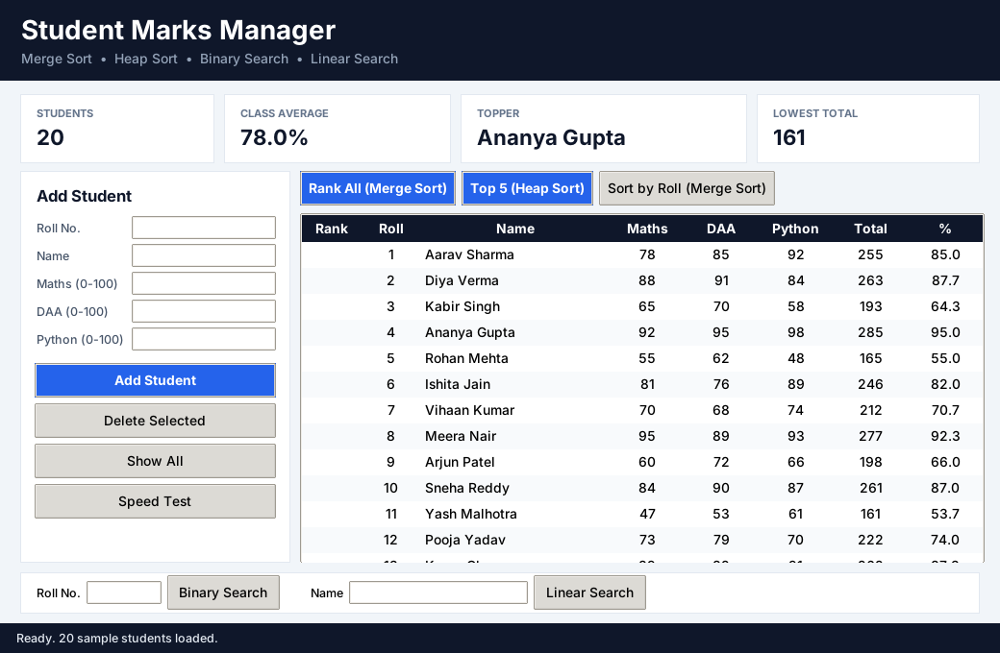
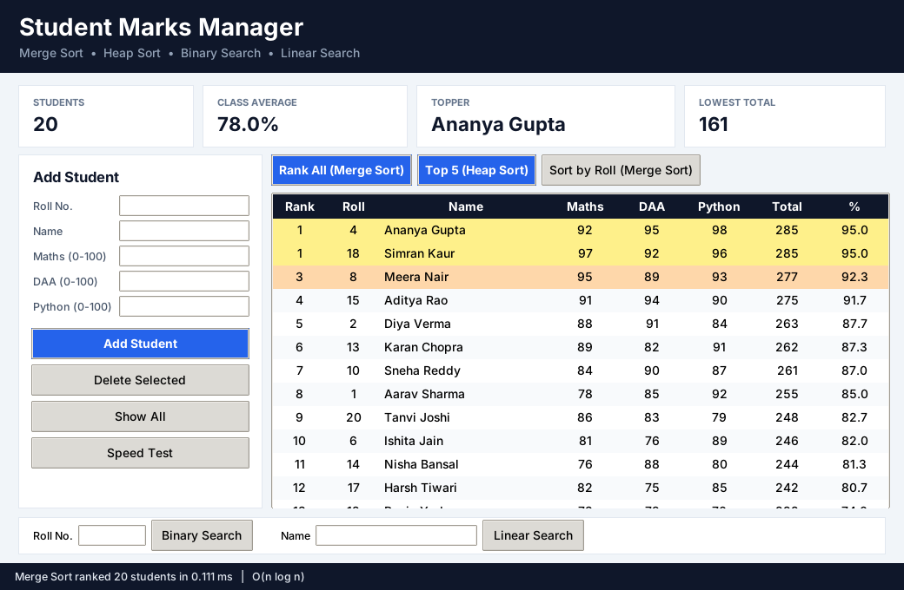
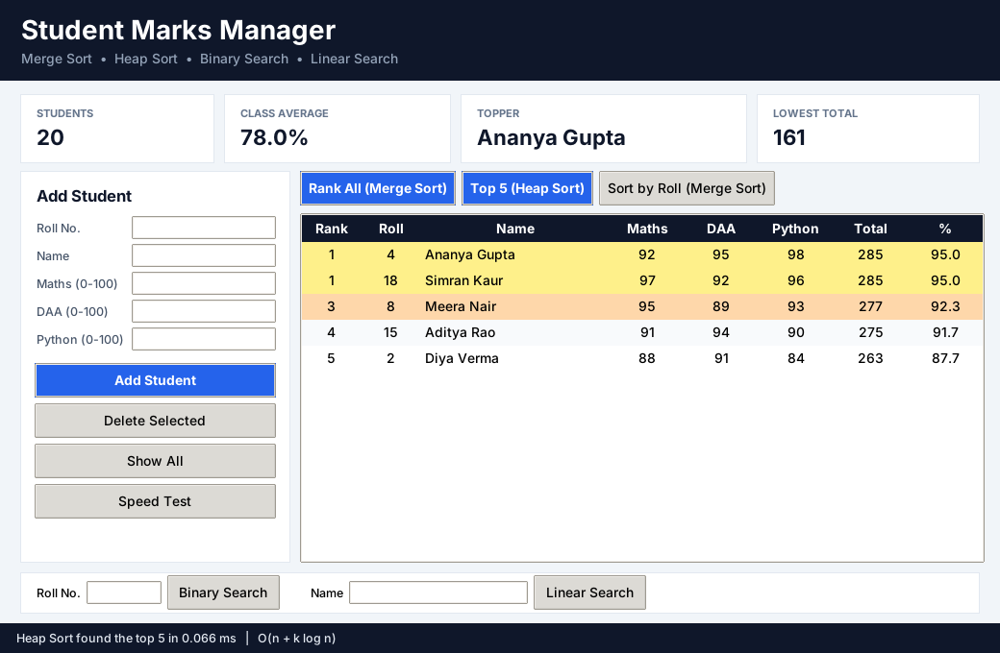
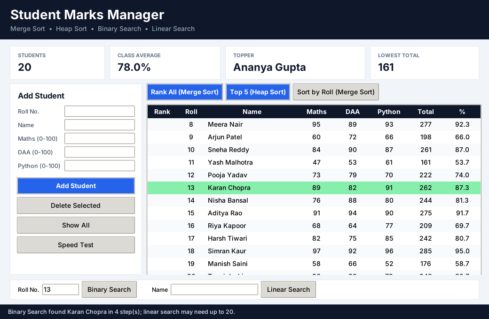
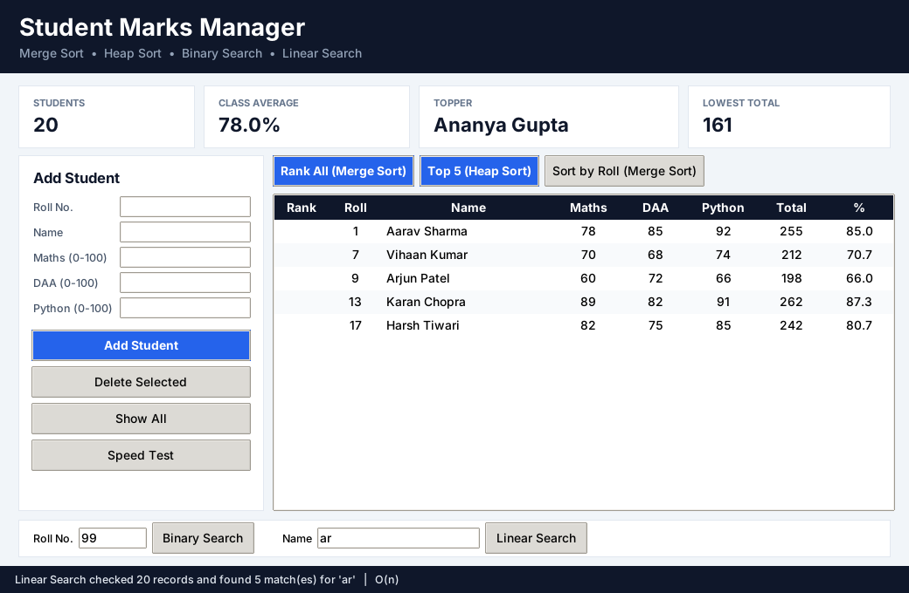
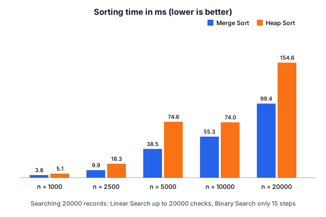

# Student Marks Manager

A desktop application in **Python + Tkinter** that ranks and searches student marks using algorithms from the
Design and Analysis of Algorithms (DAA) syllabus. Built as a DAA mini project for MCA at Chandigarh University.

All algorithms are written from scratch (no `sorted()`, `heapq` or `bisect`), and every action shows its running
time and time complexity in the status bar.

## Features

- **Rank all students** by total marks with Merge Sort (equal totals share a rank: 1, 1, 3, 4 ...)
- **Top 5 scorers** with a max-heap (the core of Heap Sort), without sorting the whole list
- **Find by roll number** with Binary Search
- **Find by name** with Linear Search (partial match, any case)
- **Add / delete students** with input validation (roll, name, marks 0-100, duplicate roll numbers)
- **Speed Test**: Merge Sort vs Heap Sort on 1,000 to 20,000 records, shown as a bar chart

## Algorithms

| Algorithm | Paradigm | Used for | Time |
|---|---|---|---|
| Merge Sort | Divide and Conquer | Ranking, order by roll | O(n log n) |
| Heap Sort | Transform and Conquer | Speed Test comparison | O(n log n) |
| Top-K (max-heap) | Transform and Conquer | Top 5 scorers | O(n + k log n) |
| Binary Search | Decrease and Conquer | Find by roll number | O(log n), needs sorted data |
| Linear Search | Brute force | Find by name | O(n) |

## How to run

Requires Python 3 with Tkinter (included in the standard Python installer for Windows and macOS;
on Ubuntu/Debian run `sudo apt install python3-tk`). No other packages are needed.

```
python student_marks_manager.py
```

## Screenshots

| Launch | Rank All (Merge Sort) |
|---|---|
|  |  |

| Top 5 (Heap) | Binary Search (roll 13) |
|---|---|
|  |  |

| Linear Search (name "ar") | Speed Test |
|---|---|
|  |  |

## Author

Kushagra, MCA, University Institute of Computing, Chandigarh University
